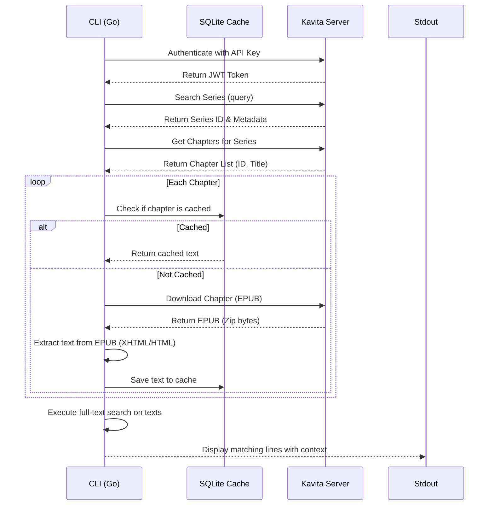

# Method: Kavita EPUB 全文検索ツールの詳細設計

## ## [Target] 全文検索のアーキテクチャ設計

### 1. データフロー

### 2. SQLite テーブル設計
CGOが不要なPure GoのSQLiteドライバ（`modernc.org/sqlite`）を使用して、以下のテーブルを構築する。

#### `chapters`
- `chapter_id` (INTEGER PRIMARY KEY): KavitaのチャプターID
- `series_id` (INTEGER): シリーズID
- `series_title` (TEXT): シリーズ名
- `chapter_title` (TEXT): チャプター名
- `content` (TEXT): パース済みのプレーンテキスト（XHTMLからタグを除去したもの）
- `cached_at` (DATETIME DEFAULT CURRENT_TIMESTAMP): キャッシュ日時

### 3. EPUB (Zip) パース仕様
1. `.epub` ファイルを `archive/zip` でオープン。
2. `OEBPS/` などのディレクトリ以下にある `.html` または `.xhtml` ファイル（あるいは `content.opf` で指定されたスピン順）を走査。
3. HTMLファイルからタグ(`<...?>`)を正規表現または簡易パーサーで除去し、プレーンテキストを抽出。
4. チャプター単位で結合し、データベースに保存。

### 4. 検索仕様
- 簡易一致（SQLの `LIKE '%query%'`）または FTS5 を利用した全文検索。
- マッチした行とその前後1行（コンテキスト）を取得してStdOutに出力。
